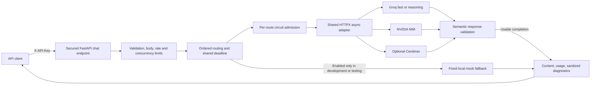
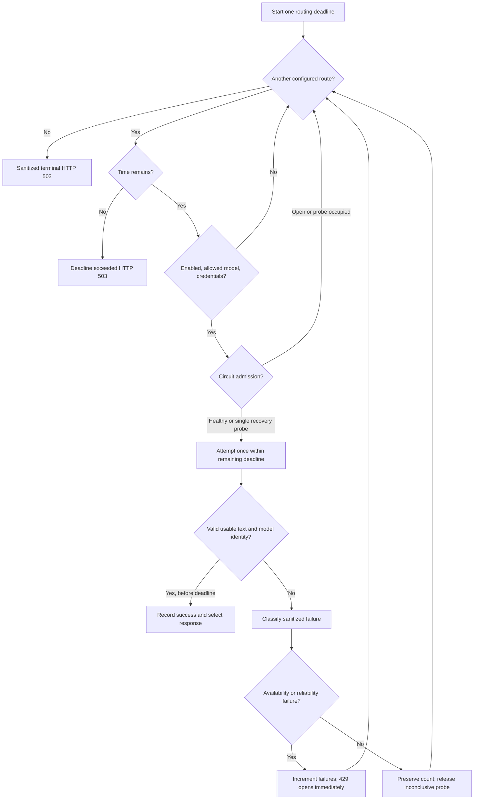
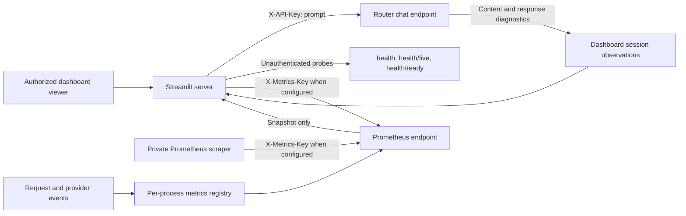
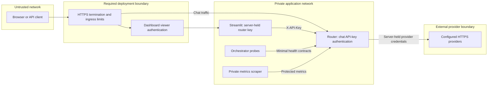

# Architecture

These diagrams describe implemented behavior. HTTPS ingress in the final diagram
is a deployment requirement, not infrastructure provisioned by this repository.

## Request path

`POST /v1/chat/completions` requires `X-API-Key`. The process exposes liveness, readiness, and Prometheus metrics endpoints. Provider state, rate limiting, and circuit breakers are in-memory and therefore scoped to one application process.

Provider-specific configuration shares one HTTP implementation; NVIDIA is not a
separate SDK path. `main.py` owns client startup/shutdown.
`app/services/provider_client.py` implements eligibility and bounded HTTP exchange.
`response_validation.py` checks every choice. The optional mock route makes no
HTTP requests and cannot satisfy an explicit model request.

## Selection and recovery

Default remote sequence: Groq fast → NVIDIA → Groq reasoning, then optional
Cerebras when enabled. An explicit model narrows eligibility without substitution.
Every route is visited once; there are no unbounded retries.
The routing timer starts after API admission; body reads and concurrency queue
waits have their own separate bounds. It is not an end-to-end HTTP-client SLA.

Breaker states are `healthy`, `unhealthy` (open), and `degraded` (half-open).
Three health failures, or immediately a 429, make the route unavailable.
`Retry-After` seconds or HTTP-date is capped at 300 seconds by default; cooldown
is at least the normal 30 seconds. Only that route is affected. One probe is
admitted after cooldown: success closes it; failure reopens it; inconclusive or
cancelled probes return to open for another recovery interval. See the
[classification table](operations.md#failure-classification-and-circuit-health).

Each atomic `CircuitBreaker.acquire` returns a single-use admission token tied
to the breaker instance, provider, and current generation. Every state transition
invalidates earlier admissions. Only the active probe's token can close, reopen,
or release that probe; late success, failure, cancellation, and neutral cleanup
from older requests cannot change its state or cooldown. Healthy requests in the
same generation can still complete concurrently and update failure counts.

For internal callers, `is_available` remains a boolean query and does not claim a
probe. Sending requires `acquire`; `record_success`, `record_failure`, and
`record_neutral` require its token through the `admission` keyword to accept an
update. Missing, consumed, foreign, or stale tokens are ignored. The provider
client releases its token in `finally`, including errors immediately after
admission. HTTP request/response contracts and failure classifications are unchanged.

## Dashboard, health, and telemetry

Session charts describe only that browser session. Response `latency_seconds`
measures the selected attempt; client wall time and routing histograms include
other work/failover. Metrics count terminal selections once and attempts
separately. Do not add total tokens to prompt/completion counts again.
No circuit information is inferred from health endpoints. Readiness checks
configuration, not connectivity. Registry and breaker state are per process.

## Deployment trust boundaries

The image runs non-root with root-owned code. Keys are server-side configuration,
not frontend assets. Metrics remain public when their optional key is unset:
protection is a required deployment choice. Ingress must also limit unauthenticated
traffic. Remote HTTP uses HTTPS without redirects or implicit environment proxies;
loopback HTTP is allowed for local demos. A shared chat key is not individual
identity. No public Streamlit deployment is included. For multiple workers or
replicas, design shared state before treating limits or breakers as global.
